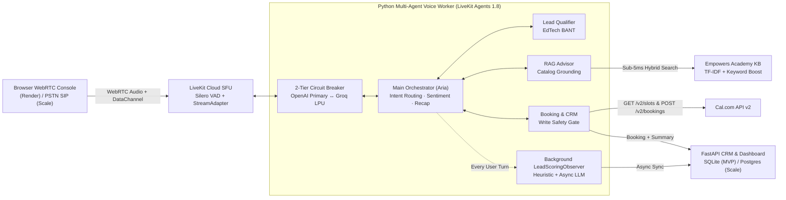

# Fortivex — AI Academy Autonomous Sales Voice Agent

[](https://fortivex-voice-crm.onrender.com/)
[](https://fortivex-voice-crm.onrender.com/dashboard)
[](#system-architecture)

An end-to-end autonomous AI sales voice agent that conducts real-time WebRTC voice conversations, qualifies inbound prospects using BANT scoring, answers curriculum and EMI objections via sub-5 ms Hybrid RAG, books live **Cal.com v2** counseling appointments, and syncs structured call intelligence into a **FastAPI + SQLite CRM dashboard**.

> **Live Prototype (Zero Login Required):**
> - **Voice Console & Chaos Failover UI:** https://fortivex-voice-crm.onrender.com/
> - **Fortivex CRM & Call Insights Dashboard:** https://fortivex-voice-crm.onrender.com/dashboard
> *(Free-tier Render/LiveKit Cloud instances spin down after idle periods; allow ~15–20 seconds on the very first cold wake-up.)*

---

## Business Problem & End-to-End Workflow

EdTech admissions teams lose high-intent inbound leads when response times exceed 5 minutes, while human SDR teams cost **$7–$12 per qualified call** and leave inconsistent CRM notes. This prototype automates the complete inbound sales cycle at **~$0.19–$0.32 per 4-minute call**:

1. **Instant Pickup & Compliance:** Prospect joins via browser WebRTC; **Aria (Main Orchestrator)** greets them with an AI-assisted recording disclosure.
2. **Real-Time Lead Qualification:** Captures role, target track, start timeline, and EMI comfort; computes a live `0–100` BANT Lead Score (`Hot / Warm / Cold`) and continuous sentiment.
3. **Zero-Hallucination Course Advising (RAG):** Grounds every tuition fee, EMI plan, syllabus, placement support, and refund answer in the Empowers Academy catalog.
4. **Live Resilience (Circuit Breaker):** Automatically fails over **OpenAI → Groq LPU** across STT, LLM, and TTS on errors—or mid-call via the UI's **Simulate OpenAI Outage** Chaos Switch.
5. **Safe Appointment Booking & CRM Sync:** Fetches real open slots (`GET /v2/slots`), enforces a **Write-Tool Safety Gate** requiring verbal confirmation of name/email/slot, executes `POST /v2/bookings`, and pushes the executive summary, next action, booking UID, and timestamped transcript to `/dashboard`.

---

## System Architecture



---

## Key Engineering Highlights

| Capability | Implementation |
| :--- | :--- |
| **Hub-and-Spoke Multi-Agent** | LiveKit native `Agent` handoffs (`Orchestrator → Qualifier / RAG Advisor / Booking`) sharing typed `CallState` and full `chat_ctx` without prompt bloat. |
| **2-Tier AI Circuit Breaker** | `FallbackAdapter` + Chaos wrappers switching **OpenAI** (`gpt-4.1-mini`, `gpt-4o-mini-transcribe`, `gpt-4o-mini-tts`) to **Groq LPU** (`openai/gpt-oss-20b`, `whisper-large-v3-turbo`, `canopylabs/orpheus-v1-english`) mid-call with zero room drop. |
| **Sub-5 ms Hybrid Voice RAG** | In-memory TF-IDF cosine similarity + EdTech keyword boosting over `knowledge_base.json` eliminates remote vector DB pauses during live speech and streams live citation chips to the UI. |
| **Background Lead-Scoring Observer** | Non-blocking `LeadScoringObserver` subscribed to `conversation_item_added` combines sub-1 ms deterministic extraction with async OpenAI/Groq JSON extraction so scores never stall voice latency. |
| **Write-Tool Safety & Security** | Zero API keys in browser (short-lived LiveKit JWTs), `X-Internal-Secret` CRM sync, DTLS-SRTP media encryption, and mandatory verbal confirmation before mutating Cal.com bookings. |

---

## Repository Structure

```text
├── agent/
│   ├── main.py                     # LiveKit AgentServer entrypoint, pre-warmed Silero VAD, DataChannel control
│   ├── failover.py                 # OpenAI <-> Groq 2-Tier FallbackAdapters + Chaos outage wrappers
│   ├── state.py                    # Shared CallState, BANT 0-100 scoring formula & live telemetry publisher
│   ├── prompts.py                  # Concise voice-optimized EdTech personas & compliance rules
│   ├── subagents/                  # Hub-and-spoke agents (orchestrator, qualifier, advisor, booking)
│   ├── rag/                        # knowledge_base.json + sub-5ms hybrid TF-IDF/keyword retriever
│   └── services/                   # calcom.py (v2 API), lead_observer.py, summarizer.py, crm_client.py
├── web/
│   ├── app.py                      # FastAPI server: /, /dashboard, /api/token, /api/crm/*
│   ├── database.py & schemas.py    # SQLAlchemy SQLite CRM models & Pydantic contracts
│   └── static/                     # Zero-build WebRTC console, Chaos Switch & CRM insights dashboard
├── scripts/                        # verify_keys.py (pre-flight check) & test_lead_scoring.py (5-case suite)
├── Dockerfile & livekit.toml       # Production worker container for LiveKit Cloud
└── render.yaml                     # Render Web Service blueprint for portal & CRM
```

---

## Quickstart (Local & Production Deploy)

```bash
# 1. Setup virtual environment
python3 -m venv venv && source venv/bin/activate
pip install -r requirements.txt
cp .env.example .env   # Add LIVEKIT_*, OPENAI_API_KEY, GROQ_API_KEY, CAL_API_KEY, CAL_EVENT_TYPE_ID

# 2. Pre-flight key check, VAD download & lead-scoring test suite
python scripts/verify_keys.py
python -m livekit.agents download-files
PYTHONPATH=. python scripts/test_lead_scoring.py

# 3. Run locally (2 terminals)
uvicorn web.app:app --host 0.0.0.0 --port 8000     # Terminal 1: Web Console & CRM
python -m agent.main dev                          # Terminal 2: Voice Worker
```

**Cloud Deployment:** Web Portal & CRM auto-deploy to **Render** via `render.yaml` (`requirements-web.txt`); the Python Voice Worker deploys to **LiveKit Cloud** via `Dockerfile` (`lk agent deploy`).

---

## Scaling Strategy (1,00,000 Users), Security & Unit Economics

Modeling **1,00,000 registered leads** at 3% peak daily engagement (~3,000 calls/day, 4-min avg) with webinar burst headroom via Little's Law ($125\text{ calls/min} \times 4\text{ min} = 500$ concurrent, provisioned for **1,000 concurrent calls**):

| Layer | MVP (Live Today) | 1,00,000-User Production Architecture |
| :--- | :--- | :--- |
| **Media & Telephony** | LiveKit Cloud Free Build (WebRTC) | Multi-region LiveKit SFU (**Mumbai `ap-south-1`** + **Dubai `me-central-1`**) + Native SIP Trunks |
| **Voice Workers** | Single LiveKit Cloud container | **Kubernetes (EKS/AKS) + KEDA** scaling 50–65 warm pods (4 vCPU / 8 GB, ~20 sessions/pod) |
| **AI & Circuit State** | Single-process `FallbackAdapter` | **Redis Cluster** shared circuit breaker + active-active OpenAI Tier-5 & Groq LPU routing |
| **RAG & CRM Data** | In-memory JSON + SQLite | **Qdrant / `pgvector` + Redis semantic cache** (<15 ms p95) + **PostgreSQL (PgBouncer)** + **Kafka** async summaries |
| **Compliance & Cost** | DPDP/PDPL disclosure + JWT auth | AES-256 KMS, PII log redaction, S3 dual-track audio · **~$0.048–$0.079/min** ($11.5K–$19K/mo at 240K min) |
